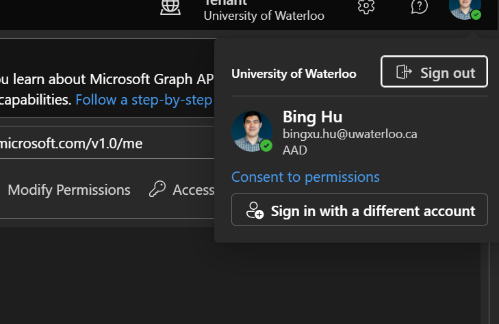
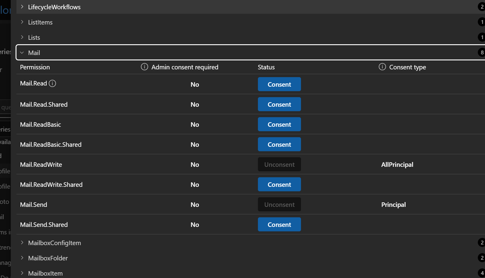
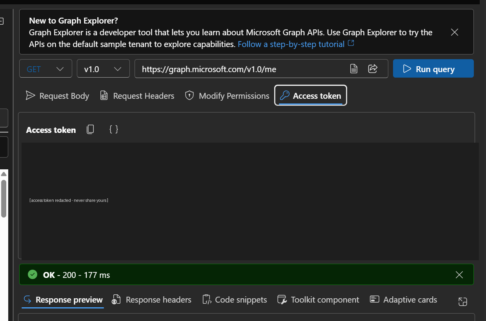

# Automated email outreach with your UW account and Microsoft Graph

Send personalized cold emails (to clinicians, industry contacts or interview subjects) from your own University of Waterloo mailbox, a few at a time, from a spreadsheet. A short Python script fills an email template from each row of a CSV and sends it through the Microsoft Graph API. It then marks the row as sent, so nobody gets emailed twice. The emails appear in your Outlook *Sent Items* like any other, and replies come to your normal inbox.

You don't need admin rights or an app registration. You sign in through Microsoft's Graph Explorer in your browser and give the script a temporary access token.

| File | What it is |
|---|---|
| `send_outreach.py` | the sender: preview, setup check, test email, batch send |
| `email_template.md` | the email, with an "ATTN:" subject line and `{{placeholders}}` |
| `recipients.csv` | example recipient list (one row per person, fake addresses) |
| `requirements.txt` | Python packages |
| `screenshots/` | the screenshots used below |

*Tested with UW accounts in October 2026. If Microsoft or UW changes its settings, Step 1 may show "Need admin approval"; see [Troubleshooting](#troubleshooting).*

---

## Before you start

- **Check that it's allowed.** Use your UW email for university and research purposes, in line with UW's acceptable-use policies. If your outreach is for a company, check whether it should come from a company address instead.
- **Send small batches.** 10–20 emails a day, and at most about 50. Microsoft's spam protection can block an account that suddenly sends lots of external email, which would cut you off from your UW email.
- **Respect anti-spam rules.** Canada's CASL and similar laws expect you to say who you are and to offer a way to opt out. The template's last line does this. Honour every opt-out straight away.
- **Treat the access token like a password.** For about an hour it can send email as you. Never paste it into a chat, document, file, screenshot or commit.

## Step 0: Install (once)

You need Python 3.9 or later.

```
git clone <this repository>
cd automated_outreach
python3 -m venv .venv
.venv/bin/pip install -r requirements.txt          # Windows: .venv\Scripts\pip install -r requirements.txt
```

In the commands below, `python` means `.venv/bin/python` (Windows: `.venv\Scripts\python`).

## Step 1: Let Graph Explorer send mail for you (once)

1. Open **[Graph Explorer](https://developer.microsoft.com/graph/graph-explorer)** and click **Sign in** (top right). Sign in with your UW account (`you@uwaterloo.ca`) through the usual UW login and MFA.
2. Click your **profile picture** (top right), then **Consent to permissions**.

   

3. In the search box type **Mail**, expand the **Mail** group, find **Mail.Send** and click **Consent**. Accept the Microsoft prompt that follows. The button changes to **Unconsent**, which means the permission is granted.

   

   You only need **Mail.Send**, which sends mail as you. The script doesn't need the read permissions.

If Microsoft says **"Need admin approval"** instead, your account isn't allowed to grant this permission. See [Troubleshooting](#troubleshooting).

## Step 2: Copy an access token (each sending session)

1. In Graph Explorer, leave the request as `GET https://graph.microsoft.com/v1.0/me` and click **Run query**. You should see **OK – 200**.
2. Click the **Access token** tab, then the **copy** icon next to "Access token".

   

3. In your terminal, run this line **on its own**:

   ```
   read -rs OUTREACH_TOKEN && export OUTREACH_TOKEN
   ```

   The cursor waits on an empty line. Paste the token (**Ctrl+Shift+V** on Linux, **Cmd+V** on macOS) and press **Enter**. Nothing is shown, which is expected: the token stays off your screen and out of your shell history. If you paste this line together with other commands, `read` takes the next command as the "token" instead.

   Windows (PowerShell 7 or later): `$env:OUTREACH_TOKEN = Read-Host -MaskInput`, then paste and press Enter.

4. Check that it worked: `echo ${#OUTREACH_TOKEN}` should print a number of 1,500 or more.

The token lasts **about an hour** and only exists in that terminal window. For the next session, or a new terminal, repeat Step 2.

## Step 3: Write your email (`email_template.md`)

The template has a subject line and a body between two `---` lines. Every `{{Name}}` is filled from the CSV column with the same name:

```
**Subject:** ATTN: {{FullName}}, {{Title}} @ {{Organization}} – {{Topic}}

---

Hi {{FirstName}},

My name is {{SenderName}} and I'm studying {{SenderProgram}} at the University of Waterloo. I'm currently investigating {{Topic}}.

My understanding is that {{Problem}}. I came across {{Personalization}}, which is why I thought of you.

As part of my investigation, I'm trying to validate a potential solution: {{Solution}}. Your expertise would be incredibly helpful in proving or disproving my hypothesis!

Would you be open to connecting for ~15 minutes on {{Slot}}?
...
---
```

- **Values that are the same for everyone**, such as your name and program, don't need a column. Pass them on the command line with `--var SenderName="Jane Doe" --var SenderProgram="engineering"`.
- **Add, remove or rename placeholders freely,** as long as each one has a CSV column or a `--var`.
- **Rows with an empty placeholder are skipped and listed,** so an email never goes out with `{{...}}` in it.

The tips at the bottom of `email_template.md` explain what makes this style work: the "ATTN:" subject, framing the problem as your understanding, one real personal detail, and a specific time slot.

## Step 4: Build your recipient list (`recipients.csv`)

One row per person:

| Column | Required | Notes |
|---|---|---|
| `Email` | yes | the recipient's address |
| `Status` | yes (created if missing) | leave empty or `Not contacted`; the script fills in `Sent 2026-10-20 14:05` or `Error: ...` |
| `Cc` | no | addresses to copy, separated by `;` |
| anything else | as your template needs | e.g. `FullName`, `FirstName`, `Title`, `Organization`, `Topic`, `Personalization`, `Slot` |

How to make it:
- **Build it in Excel or Google Sheets** and save it as **CSV UTF-8**. In Excel that's *Save As → CSV UTF-8*; in Google Sheets, *File → Download → .csv*.
- **Keep the real list out of the repository.** Name it `something.local.csv` (ignored by `.gitignore`) and pass `--csv something.local.csv`. Real lists contain people's personal email addresses.
- **Close the file in Excel while sending.** The script saves progress into it after every email. If the file is locked, it pauses and asks you to close it.
- **Several people sending from one list?** Split the rows between you first. Each person's Status updates go only into their own copy.

## Step 5: Preview, check, test, send

Run these from the `automated_outreach` folder, in this order:

```
# 1. Preview the next 3 emails exactly as they will be sent. No sign-in, nothing sent.
python send_outreach.py --dry-run --limit 3 --var SenderName="Jane Doe" --var SenderProgram="engineering"

# 2. Check that everything is ready: token, mailbox, template, CSV. Nothing sent.
python send_outreach.py --check --var SenderName="Jane Doe" --var SenderProgram="engineering"

# 3. Send the next email to YOURSELF, marked [TEST]. The CSV isn't changed.
python send_outreach.py --test-self --var SenderName="Jane Doe" --var SenderProgram="engineering"

# 4. Send to the next 10 people. It shows a summary and asks you to confirm first.
python send_outreach.py --limit 10 --var SenderName="Jane Doe" --var SenderProgram="engineering"
```

After step 3, open the test email in Outlook and read it as the recipient would, then continue.

A real batch prints one line per email, about 90 seconds apart, so 10 emails take about 15 minutes. Keep the terminal open until it says `Done`.

```
Signed in as Jane Doe <jdoe@uwaterloo.ca>; token valid for about 57 min
About to send 10 email(s) from jdoe@uwaterloo.ca, about 90 s apart (~15 min).
Send them now? [y/N] y
sent 1/10: sarah.smith@example.org
sent 2/10: alex.chen@example.com
...
Done: 10 sent, 0 rejected. Progress is saved in recipients.csv.
```

### All options

| Option | What it does |
|---|---|
| `--dry-run` | print the emails instead of sending them; no sign-in needed |
| `--check` | sign in and check the token, your mailbox, the template and the CSV; sends nothing |
| `--test-self` | send the next email to your own address, marked [TEST]; the CSV isn't changed |
| `--test-to ADDRESS` | the same, sent to another address, such as a teammate who reviews it |
| `--limit N` | most emails to send in this run (default 10) |
| `--only ADDRESS` | send only to this one recipient from the CSV |
| `--delay S` | average seconds between emails (default 90, randomized, never under 20) |
| `--var NAME=VALUE` | fill a placeholder that is the same for everyone (repeatable) |
| `--csv FILE` / `--template FILE` | use a different recipient list or template |
| `--yes` | skip the confirmation question, for example in a scheduled job |
| `--max-errors N` | stop after N rejected addresses in one run (default 3) |
| `--client-id` / `--tenant` | sign in with your own app registration instead of a pasted token (see below) |

Run `python send_outreach.py --help` for the same list.

## What happens when something goes wrong

The script saves after every email, so you can always run the same command again. It skips everyone already marked `Sent`.

| Situation | What the script does |
|---|---|
| Token missing, too short, without Mail.Send or expired | stops before sending, and says which and how to fix it |
| Token expires during a batch | stops cleanly before the next email; get a fresh token and re-run |
| Internet drops, or Microsoft is busy (429, 5xx) | waits and retries automatically, up to about 10 minutes |
| One address is rejected (400 or 404) | marks that row `Error: ...`, continues, and stops after `--max-errors` rejections |
| Your mailbox is refused (403) | stops; a message about quota or restriction means your account may be blocked from sending, so contact IT |
| Invalid or duplicate address in the CSV | skips the row and lists it before anything is sent |
| A placeholder has no value | skips the row and names the missing column |
| CSV not UTF-8, missing `Email` column, or broken template | stops with an explanation |
| CSV open in Excel | pauses and asks you to close it, so no progress is lost |
| You press Ctrl+C | stops, keeping everything sent so far marked |

Every send and rejection is also appended to `<your csv name>_sent_log.csv`. To retry a row marked `Error:`, fix the address and clear its Status.

## After sending

- **Replies** arrive in your normal UW inbox. Update the row's `Status` by hand, for example `Replied 2026-10-22`, `Meeting booked` or `Do not contact`. Any Status other than empty or `Not contacted` is never emailed again.
- **One polite follow-up** after 5–7 days is fine. Make a follow-up template, put the rows back to `Not contacted`, and run with `--template followup.md`.
- **Opt-outs:** set `Do not contact` straight away.

## Troubleshooting

| Message | Fix |
|---|---|
| `no token` | Do Step 2 in the **same terminal** you run the script in. |
| `doesn't look like an access token (NN characters...)` | The paste didn't take, or `read` swallowed a command. Run the `read` line on its own and paste again. |
| `this token has no Mail.Send permission` | Do Step 1, then run any query in Graph Explorer and copy a **fresh** token. |
| `this token has expired` / `401` | Copy a fresh token (Step 2) and re-run the same command. |
| **"Need admin approval"** in Graph Explorer | Your account can't grant Mail.Send itself. Ask IT for approval, or send by hand. |
| `403 ... quota` / `restricted` | Stop sending. Your account may be temporarily blocked from sending. Contact IT before trying again. |
| `nothing to send` | Every row is sent, has a non-empty Status, or is missing a placeholder value. The `SKIPPED` lines above it say which. |
| Test email not in your inbox | Check *Junk*. Also check *Sent Items* in Outlook on the web to confirm it left. |

### Optional: sign in with your own app instead of a pasted token

If your organization lets you register apps (UW students usually can't), you can avoid copying a token each hour:
1. In [entra.microsoft.com](https://entra.microsoft.com), go to *App registrations → New registration*, choose "single tenant" and leave the redirect URI empty.
2. Under *Authentication*, turn on **Allow public client flows**.
3. Under *API permissions*, add Microsoft Graph → Delegated → **Mail.Send**.
4. Run `pip install msal` and pass `--client-id <Application ID> --tenant <Directory ID>`.

The first run prints a code to enter at microsoft.com/devicelogin. After that, the sign-in is remembered in `~/.config/graph_outreach/`.

## How it works

The script reads the template and the CSV, fills each row's placeholders, and calls `POST https://graph.microsoft.com/v1.0/me/sendMail`, Microsoft's documented API for sending mail as the signed-in user. It sends plain-text emails, saved to *Sent Items*. Before sending, it reads only the permission list and expiry time from the token, and it never prints or stores the token. Nothing is sent anywhere except to Microsoft.

## License

MIT, see [LICENSE](LICENSE).
